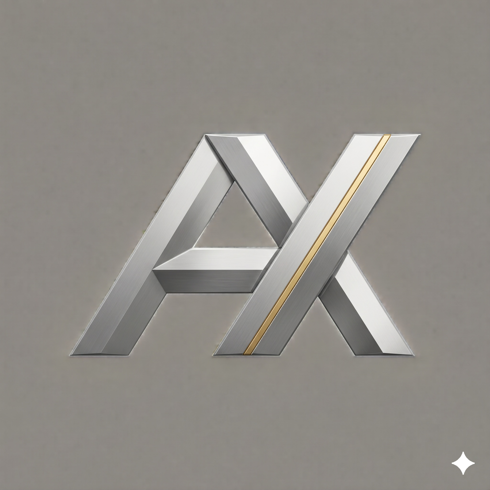

# 🚀 AURIX PRO — Institutional Personal Wealth & Money Management

<div align="center">



**"Precision in every paisa, beauty in every pixel."**

[](https://github.com/aadhixr/MONETRA/releases)
[](https://github.com/aadhixr/MONETRA/actions)
[](https://github.com/aadhixr/MONETRA)
[](LICENSE)

</div>

---

## 🏛️ Executive Summary

**AURIX PRO** is a commercial-grade, privacy-first personal wealth and finance management system engineered for luxury dark fintech aesthetics. Built with modern web and native mobile technologies, AURIX PRO operates with double-entry financial rigor—eliminating floating-point inaccuracies through an exact 2-decimal calculation engine.

100% of user data is stored locally on-device inside IndexedDB. AURIX PRO includes optional end-to-end encrypted cloud vault synchronization via Supabase (`AES-GCM 256-bit`).

---

## 🌟 Full Feature Set & Capability Matrix

### 🧮 1. Precision Financial Engine & Double-Entry Ledger
- **Strict Two-Decimal Standard**: Computes exact balance reconciliation formatted as `₹0.00`, preventing floating-point calculation drift.
- **Liquid Spending vs Protected Savings**: Automatically segregates spendable bank/cash liquid balances from protected savings reserves.
- **Neutral Inter-Account Transfers**: Transfers between Bank, Cash, and Savings Reserves are neutral—preventing artificial inflation of monthly income or expenditures.
- **Insufficient Balance Protection**: Real-time validation flags transactions or transfers that exceed available liquid funds before execution.
- **Self-Healing Reconciliation**: Historical transactions automatically adjust total net worth and closing balances without corrupting historical periods.

### 🤖 2. AI Financial Insights & Query Engine
- **Natural Language Assistant**: Answers real-time financial queries:
  - *"How much did I spend this month?"* -> Returns exact aggregated expenditures.
  - *"What was debited?"* -> Filters and displays verified debit entries.
  - *"Can I afford ₹15,000?"* -> Computes real-time affordability against available liquid balance.
- **Smart Category Engine**: Auto-identifies expenditure categories from merchant names and keywords (e.g. *Biryani / Dosa* -> Food; *Jio / Airtel* -> Mobile Recharge; *Rent* -> Housing).

### 💼 3. Multi-Account & Savings Architecture
- **Account Types**: Primary Bank Accounts, Cash Wallets, and Savings Reserves.
- **Savings Vault Protection**: Savings funds are strictly excluded from spendable totals.
- **Auto-Reconciling Transfer Modal**: Selecting a source account automatically selects a distinct destination account.

### 📊 4. Smart Budget Engine & Threshold Alerts
- **Dynamic Threshold Monitors**: Triggers 3 visual alert statuses based on consumption:
  - 🟡 **Warning** (83.3% consumed)
  - 🟠 **Strong Warning** (92% consumed)
  - 🔴 **Exceeded** (105% consumed)
- **Salary Auto-Budgeting**: Credited salary automatically sets the monthly base budget with usage percentage calculations.

### 🗓️ 5. Financial Calendar & Multi-Month Isolation
- **Timezone Drift Protection**: Navigates between months and years (`2026-01` -> `2025-12` or `2026-12` -> `2027-01`) without date shifting.
- **Historical Ledger Isolation**: Historical monthly closing balances remain immutable against earnings in future months.

### 🎨 6. 8 Luxury Themes
Defaulting to **Monochrome Obsidian**, AURIX PRO features 8 switchable luxury themes:
1. 🖤 **Monochrome Obsidian**
2. 🪙 **Classic Gold**
3. 🟩 **Neon Mint**
4. 🟣 **Cyberpunk**
5. 🌹 **Velvet Rose**
6. 💙 **Royal Sapphire**
7. 💎 **Emerald Luxury**
8. ⚙️ **Titanium Steel**

### 🔐 7. Encrypted Cloud Sync & Data Security
- **AES-GCM 256-bit Client Encryption**: Vault data is encrypted with client passphrase before leaving the device.
- **Supabase Cloud Vault**: Secure cloud backup to user's personal Supabase database table (`monetra_backups`).
- **Connection Diagnostics**: Built-in test button verifies Supabase URL, Anon Key, and Row Level Security (RLS) status.
- **Local JSON Export & Import**: One-click offline backup and restore.

### 📱 8. Native Android & iOS Integration
- **3D Metallic AX Monogram**: High-resolution launcher icon padded cleanly across all Android density folders (`mdpi` to `xxxhdpi`) and iOS AppIcon set.
- **Native Android Back Button Stack**:
  - Closes active modals in priority order.
  - Navigates back through tab history (Insights/Savings/Budget -> Home).
  - Minimizes app cleanly from root Home screen.
- **Native Xcode iOS Support**: Pre-configured Capacitor iOS project (`ios/App/App.xcodeproj`).
- **Wireless Updates (OTA)**: Integrated update checker checks GitHub Releases API for 1-click APK installation.

---

## 🧪 Automated Financial Validation Test Suite (33/33 Passed)

AURIX PRO includes an automated test runner validating all 33 financial logic test cases:

```bash
npm test
```

### ✅ Summary of Validated Tests:
- `TEST 1`: Cash account creation with ₹10,000 -> verified ₹10,000.
- `TEST 2`: Salary addition of ₹35,000 -> verified ₹45,000.
- `TEST 3`: Food expense of ₹250 -> verified ₹44,750.
- `TEST 4A-4E`: Inter-account transfer to savings (₹5,000) -> verified liquid spending ₹39,750, savings ₹5,000, neutral income/expense.
- `TEST 5-6`: Expense edit & deletion balance restoration.
- `TEST 7`: Cross-month ledger immutability (Nov vs Dec).
- `TEST 8A-8C`: Multi-tier budget alerts (83.3%, 92%, 105%).
- `TEST 9-13`: Savings contribution isolation, loss-free serialization, 100% offline calculations, AES-GCM restore, zero duplicate collision.
- `TEST 14A-14D`: AI natural language answering grounded in verified ledger figures.
- `TEST 15-20`: Backdated salary calculations, timezone navigation, insufficient balance protection.
- `TEST 21-25`: Merchant category identification, food & recharge keywords, lending money audit matrix, monthly budget auto-setting.
- `TEST 26-30`: Two-decimal currency formatting (`₹0.00`), self-healing balance reconciliation, spendable isolation, multi-theme engine, budget tab reconciliation.
- `TEST 31-33`: Account auto-selection, backup file restoration, physical device ADB extraction validation.

---

## 🛠️ Getting Started & Local Development

### Prerequisites
- **Node.js** >= 18.0
- **npm** >= 9.0
- **Android Studio** (for Android APK builds)
- **Xcode** (for macOS iOS builds)

### Installation
```bash
git clone https://github.com/aadhixr/MONETRA.git
cd monetra
npm install
```

### Start Development Server
```bash
npm run dev
```
Open browser at `http://localhost:3000`.

### Run Test Suite
```bash
npm test
```

### Production Build
```bash
npm run build
```

---

## 📱 Mobile Platform Builds

### Android Native Build
```bash
# 1. Sync web dist into Android project
npx cap sync android

# 2. Compile release APK using Gradle
cd android
./gradlew assembleRelease
```
The compiled signed APK will be output to:
`android/app/build/outputs/apk/release/app-release.apk`

### iOS Native Build (macOS)
```bash
# 1. Sync web dist into iOS project
npx cap sync ios

# 2. Open project in Xcode
npx cap open ios
```
In Xcode, select target device and press **Run (⌘R)**.

---

## 💻 Developer & Credits

<div align="center">

### **Lead Architect & Developer**
### **Aadhi**
[@aadhixr](https://github.com/aadhixr)

**Repository**: [https://github.com/aadhixr/MONETRA](https://github.com/aadhixr/MONETRA)  
**Package ID**: `io.aurix.app`

---

### 📄 License
This project is licensed under the **MIT License** — see the [LICENSE](LICENSE) file for details.

*Copyright © 2026 Aadhi. All rights reserved.*

</div>
